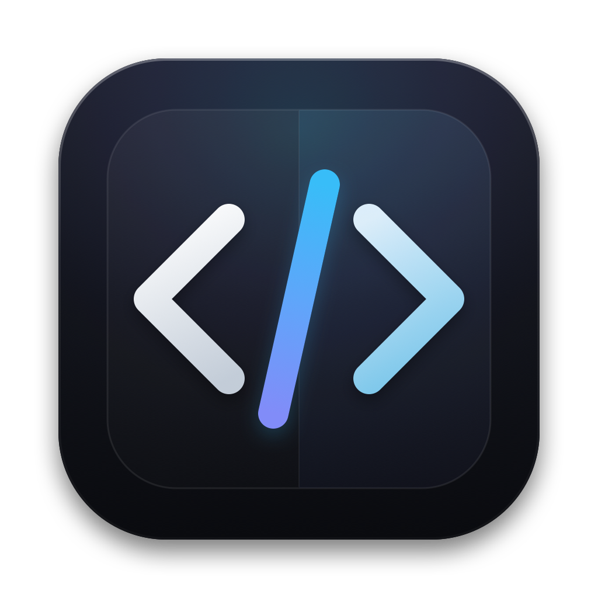
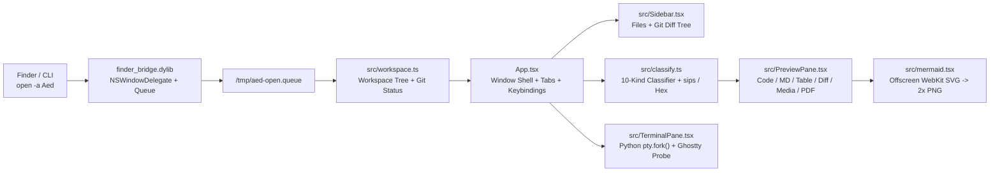

<div align="center">
  
  <h1>Aed</h1>
  <p><strong>Another editor for code, documents, data and media.</strong></p>
  <p>
    Lightweight native macOS editor, 10-format previewer, and multi-tab PTY terminal built on Native Shell (<code>nsh 0.3.0</code>).<br />
    Zero Electron. Zero network telemetry. ~17 MB standalone Apple Silicon bundle.
  </p>
  <p>
    <a href="#installation">Install</a> ·
    <a href="#format-matrix">Format Matrix</a> ·
    <a href="#keyboard-shortcuts">Shortcuts</a> ·
    <a href="#architecture">Architecture</a> ·
    <a href="#development">Development</a> ·
    <a href="DESIGN.md">Design Spec</a>
  </p>
</div>

---

## Installation

### One-Line Install (macOS Apple Silicon)

Downloads the latest signed release, installs `/Applications/Aed.app`, and clears macOS Gatekeeper quarantine attributes automatically:

```sh
curl -fsSL https://raw.githubusercontent.com/RoacherM/native-editor/master/install.sh | sh
```

### Manual Download (DMG / ZIP)

Grab [`Aed-0.0.1-macos-arm64.dmg`](https://github.com/RoacherM/native-editor/releases/latest) or [`Aed-0.0.1-macos-arm64.zip`](https://github.com/RoacherM/native-editor/releases/latest) from [Releases](https://github.com/RoacherM/native-editor/releases), drag **Aed.app** into `/Applications`, and clear quarantine on first launch:

```sh
xattr -cr "/Applications/Aed.app"
```

### Opening Files & Workspaces from Finder or CLI

- **Finder**: Double-click any associated file, or drag a file/folder onto the **Aed** Dock icon (`scripts/finder_bridge.m` forwards `application:openFiles:` and `application:openURLs:` directly into the running workspace without spawning duplicate windows).
- **Terminal**:
  ```sh
  open -a Aed /path/to/project
  open -a Aed README.md
  ```

---

## Format Matrix

Aed classifies every file by extension, content signature, and byte stream (`src/classify.ts`), routing it to a dedicated native view:

| Category | Formats | Renderer & Capabilities |
|---|---|---|
| **Code** | `.ts` `.tsx` `.js` `.rs` `.py` `.go` `.c` `.m` `.swift` `.json` `.toml` `.yaml` `.sh` `.sql` + 30 more | Native `CodeEditor` with syntax highlighting, inline Find (`⌘F`), dirty tracking (`●`), and `⌘S` save |
| **Markdown** | `.md` `.mdx` `.markdown` | Switchable **Preview / Editor** (`⌘⇧V`). Inline ` ```mermaid ` fences render offline via headless WebKit SVG + 2x Retina PNG |
| **Mermaid** | `.mmd` `.mermaid` | Standalone diagram canvas with `25%`–`300%` zoom, `1:1` reset, and **Diagram / Code** toggle |
| **Tables** | `.csv` `.tsv` `.jsonl` | Native `DataTable` grid (up to 500 rows) with RFC-4180 quote parsing, column/row badge, and **Table / Raw Source** toggle |
| **Git Diff** | `.diff` `.patch` & modified workspace files | Native `DiffView` supporting **Unified** and **Split** side-by-side comparison with `+N / -N` line counters |
| **Images** | `.png` `.jpg` `.jpeg` `.gif` `.webp` `.bmp` `.ico` `.tiff` `.svg` | Resolution inspection via `sips`, `25%`–`400%` zoom controls, and dark/checkerboard backdrop toggle |
| **PDF** | `.pdf` | 2x Retina (`1800px`) rasterization mounted on an archival `#f7f4ee` paper sheet with `50%`–`300%` zoom |
| **Video** | `.mp4` `.mov` `.m4v` `.webm` | Native macOS `Video` player with playback controls and file size metadata |
| **Audio** | `.wav` `.mp3` `.m4a` `.aac` `.flac` `.ogg` | Native macOS `Audio` player card with transport controls |
| **Binary** | Executables, archives, or streams with `NUL` bytes | First `4096` bytes formatted as a 16-byte-aligned Hex + printable ASCII dump |

---

## Workspace, Terminal & Themes

- **Swiss Structural Grid & Guarded Layout**:
  - Asymmetrical poster welcome screen (`WelcomePanel`) when no workspace is open, transitioning into a 3-pane dock (`Sidebar` + `Editor / Preview` + `TerminalPane`) backed by `ResizablePanelGroup`.
  - Enforced `760 × 520pt` minimum window geometry in both AppKit (`windowWillResize:toSize:`) and TSX layout bounds so panes never collapse or overlap.
- **Interactive Multi-Tab PTY Terminal**:
  - Real pseudo-terminal sessions spawned via Python `pty.fork()` (`src/TerminalPane.tsx`), supporting `cd` working directory sync, ANSI escape filtering, 50-entry command history (`↑`/`↓`), `Ctrl-C` (`\x03`), and `Ctrl-D` (`\x04`).
  - Switch between installed shells (`zsh`, `fish`, `bash`, `nu`, `sh`) directly from the terminal header or Preferences (`⌘,`).
  - Automatically inherits `font-family` and `font-size` from `~/.config/ghostty/config` when present.
- **8 Built-in Themes**:
  - **Industrial Paper** (warm archival light) & **Industrial Carbon** (matte dark) designed specifically for Aed.
  - Plus **Kanagawa Dragon** (default dark), **Kanagawa Wave**, **Tokyo Night**, **Catppuccin Mocha**, **Gruvbox Dark**, and **Rosé Pine Dawn**.

---

## Keyboard Shortcuts

| Shortcut | Action |
|---|---|
| `⌘O` | Open Folder / Workspace via native macOS file panel |
| `⌘P` / `⌘K` | Quick Open file in workspace (`QuickOpenDialog`) |
| `⇧⌘P` | Command Palette (`CommandPaletteDialog`) |
| `⌘B` | Toggle left File Explorer / Git Changes sidebar |
| `⌘J` / `` Ctrl+` `` | Toggle bottom interactive PTY terminal panel |
| `⌘F` | Toggle inline Find bar in code & text editors |
| `⌘S` | Write active buffer to disk and refresh Git status |
| `⌘W` | Close active tab |
| `⌘⇧V` | Toggle Markdown rendered preview vs. source editor |
| `⌘,` | Open Preferences (Theme, Font Family, Font Size, Default Shell) |
| `⌘=` / `⌘-` / `⌘0` | Zoom editor & terminal font size (`10px` – `26px`, reset `13px`) |

---

## Architecture



| Path | Responsibility |
|---|---|
| [`App.tsx`](App.tsx) | Window shell, titlebar, `ResizablePanelGroup`, tabs, dialogs, and shortcut routing |
| [`src/workspace.ts`](src/workspace.ts) | Directory scanner, Git status/diff runner, and `/tmp/aed-open.queue` consumer |
| [`src/classify.ts`](src/classify.ts) | 10-format file classifier, CSV/TSV/JSONL parser, Hex formatter, and `sips` PDF/image probe |
| [`src/PreviewPane.tsx`](src/PreviewPane.tsx) | Format-specific viewers (`CodeEditor`, `Markdown`, `DataTable`, `DiffView`, `Image`, `Video`, `Audio`, `QuickLookBody`, `Binary`) |
| [`src/mermaid.tsx`](src/mermaid.tsx) | Offline Mermaid syntax validator, offscreen WebKit SVG renderer, and 2x Retina PNG cache |
| [`src/TerminalPane.tsx`](src/TerminalPane.tsx) | Multi-tab PTY session manager, shell selector, and Ghostty config detector |
| [`src/Sidebar.tsx`](src/Sidebar.tsx) | Collapsible directory tree and Git working-tree change list |
| [`src/themes.ts`](src/themes.ts) | 8 color palettes, syntax token colors, and font stacks |
| [`scripts/`](scripts/) | `launcher.c` (`Aed` Mach-O entrypoint), `finder_bridge.m` (`DYLD_INSERT_LIBRARIES` AppleEvent + window min-size hook), `set_default_handlers.m`, and `package-macos.sh` |

For persistence keys (`aed.*`), environment variables (`AED_*`), IPC paths (`/tmp/aed-*`), and native packaging invariants, see [`DESIGN.md`](DESIGN.md).

---

## Development

Requires [Native Shell (`nsh 0.3.0`)](https://github.com/RoacherM) and Xcode Command Line Tools on macOS (Apple Silicon):

```sh
nsh check                           # TypeScript 7 native typecheck (~0.2s)
nsh test --trace                    # Headless unit + desktop E2E test suite
nsh test App.tsx --target macos     # Real AppKit window integration test
nsh run --target macos              # Development host with hot reload
sh scripts/package-macos.sh         # Build, sign, install /Applications/Aed.app, and create DMG/ZIP
```

To register **Aed** as the macOS default handler for core document/data types (`.md`, `.txt`, `.json`, `.jsonl`, `.yaml`, `.toml`, `.csv`, `.tsv`), or for all supported source extensions:

```sh
.nsh/out/Aed.app/Contents/MacOS/set_default_handlers          # Core 8 document/data UTIs
.nsh/out/Aed.app/Contents/MacOS/set_default_handlers --all    # All 50+ code & document UTIs
.nsh/out/Aed.app/Contents/MacOS/set_default_handlers md json  # Specific extensions only
```
