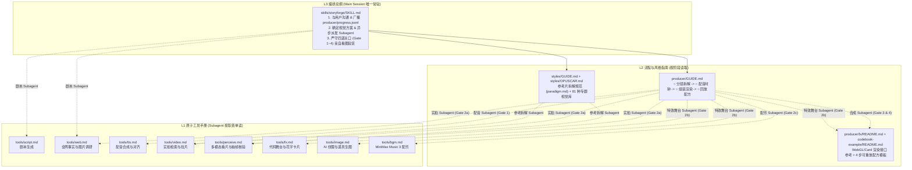
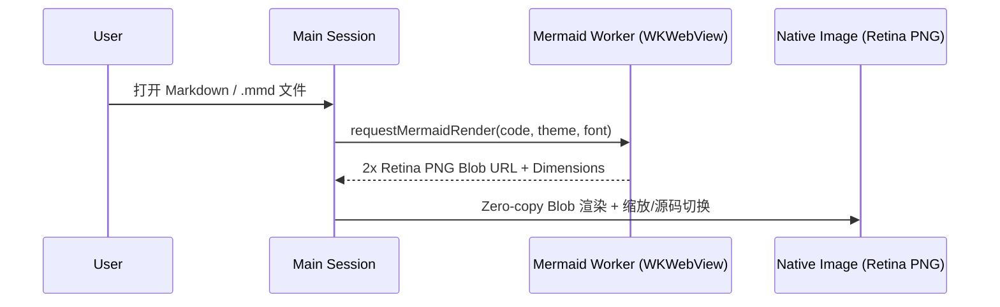

# 一、文档分层与主从 Subagent 职责架构

StoryForge 技能包按三层结构组织，主 Session 与 6 类专职 Subagent 各司其职：



## 二、端到端渲染时序



## 三、功能验证样例

### 根因

> [!NOTE]
> 这是一条提示（note）块。

> [!WARNING]
> 这是一条警告（warning）块。

- [x] 已完成任务
- [ ] 待办任务

脚注标记示例[^sample]。

[^sample]: 这是脚注内容。

行内数学 $E=mc^2$ 与块级数学：

$$
\int_0^1 x^2 \, dx = \frac{1}{3}
$$

| 名称 | 数量 | 说明 |
|---|---|---|
| 甲 | 12 | 表格单元格 |
| 乙 | 34 | 第二行 |

```ts
const answer: number = 42;
function greet(name: string): string {
  return `hello, ${name}`;
}
```

```python
def fib(n):
    return n if n <= 1 else fib(n - 1) + fib(n - 2)
```

相对图片示例：


- [外部链接 https://example.com](https://example.com/docs)
- [相对链接 README](./README.md)

### 根因

重复标题的锚点应当去重为 `根因-1`。
